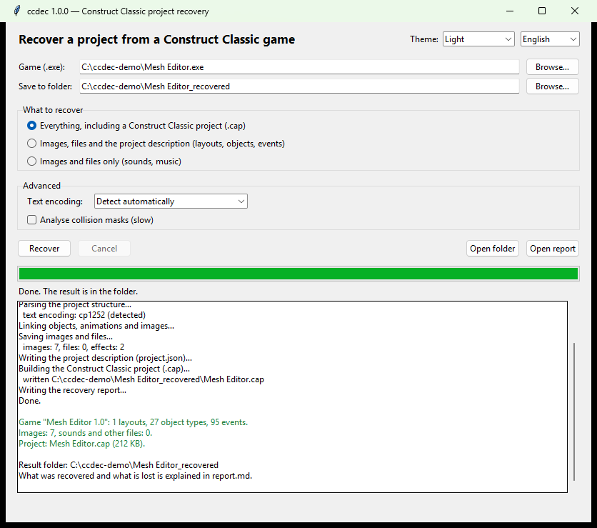
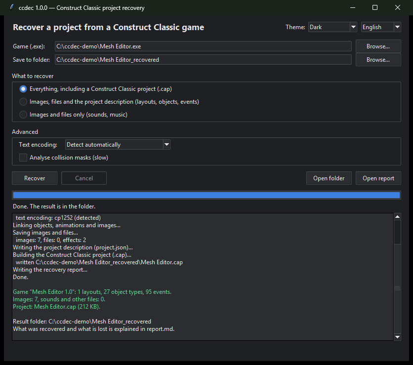

# ccdec — recover Construct Classic projects from exported games

**[Русская версия](README.ru.md)**

Lost the `.cap` of a game you made in **Construct Classic** (0.99.x – r2), but still have the `.exe`?
`ccdec` gets back the images, sounds, the project structure and events — and rebuilds a `.cap` file
that opens in Construct Classic again.

- **Level 1** — assets: images named after their objects and animations, sounds and other files,
  effects, the icon.
- **Level 2** — `project.json`: settings, layouts, layers, objects with their properties, behaviors,
  families, global variables and the full event tree as readable text.
- **Level 3** — a `.cap` project for Construct Classic.
- A report that says what was recovered, what the exporter threw away and why.

The game is never run: the file is only read, with strict bounds checking. No protection is bypassed —
Construct Classic exports store the project unencrypted.

> **Please use it for your own games, or with the author's permission.** Restoring your own lost work
> is what ccdec is for; do not publish other people's assets or projects without their consent.

## Download and run

1. Install **Python 3.8 or newer** from [python.org](https://www.python.org/downloads/). Windows 7 works:
   use Python 3.8.10 ("Windows installer", 32- or 64-bit; Windows 7 SP1 with updates).
2. Download `ccdec-<version>.zip` from the [Releases](../../releases) page and unpack it anywhere.
3. Double-click **`ccdec-gui.pyw`** (if nothing happens, run `ccdec-gui.bat` — it shows the error).

| Light | Dark |
|---|---|
|  |  |

Choose the game `.exe`, choose what to recover, press **Recover**. When it finishes, **Open folder**
and **Open report**. The window speaks English and Russian and has light and dark themes ("System"
follows the Windows app mode on Windows 10/11) — both switches are in the top-right corner and are
remembered.

No third-party packages are needed — only the Python standard library (tkinter for the window; on
Linux install `python3-tk`).

## Opening the result in Construct Classic

Construct Classic is a non-Unicode program. If your game has non-English text (for example Cyrillic)
or the output folder has non-English characters in its path, set Windows to the matching language for
non-Unicode programs: **Control Panel → Region → Administrative → Change system locale** (leave the
"Beta: UTF-8" box unchecked) and restart. Otherwise the editor silently refuses to open such files and
shows the text garbled. ccdec warns you when this applies.

Sounds and other files are linked to the `.cap` by path, exactly as in an original `.cap`: keep the
`files` folder next to it, or relink them in the editor's Files list.

## Command line

```bash
python -m ccdec game.exe -o out --level 3 --report
```

| Option | What it does |
|---|---|
| (none) | summary: data blocks, plugins, files, parsed structure |
| `--level 1` / `2` / `3` | assets / + `project.json` / + `<name>.cap` |
| `--report` | the recovery report (also saved as `out/report.md`) |
| `--lang en` / `ru` | report language (default: from the system) |
| `--compare-cap X.cap` | compare the project from the exe with an existing `.cap` (exit code 3 if different) |
| `--compare-exe X.exe` | compare with another exe, e.g. one re-exported from the rebuilt `.cap` |
| `--masks` | analyse collision masks and save custom ones (slow on big images) |
| `--raw` | dump the raw data blocks and plugin DLLs to `out/raw` |
| `--encoding cp1251` | code page of the project's text (default: detected, cp1251 or cp1252) |
| `-v`, `-vv` | verbose log |

Exit codes: 0 success, 1 unreadable file or no `.cap` possible, 3 the comparison found differences.

## What cannot be recovered

The Construct exporter drops data only the editor needs. No tool can get it back from an `.exe`:

- **Event sheets and includes** — the `.exe` has one flat event list per layout.
- **Disabled events and comments** — not exported.
- **The exact spelling of expressions** — only tokens are stored: `and`/`&`, `floor`/`int`, `.X`/`Object.X`
  become the same. The meaning is preserved.
- **The position of a trigger inside its group** — the exporter moves triggered events out; ccdec puts
  them back into their group, at its end.
- **Names of images and files** — rebuilt from objects and animations; files are numbered.
- **Effect sources (`.fx`)** — only compiled bytecode (the stock effects ship with Construct).
- **Sounds/Music lists** — only the Files list goes into the `.exe`.
- **Editor-only data** — object folders, object icons, grid, locks, separate collision images,
  fractional positions.

For plugins whose source is not available, the types of event parameters are unknown. ccdec can learn
them from any `.cap` you still have:

```bash
python tools/learn_aces.py old_project.cap --encoding cp1251
```

## How well does it work?

Checked against games whose original `.cap` is known:

| | Result |
|---|---|
| Images | byte-identical to those in the original `.cap` |
| Events | the full event tree of the Mesh Editor sample (71 events, 6 groups, 368 parameters) matches its `.cap` |
| `.cap` rebuild | a 75-layout game: the rebuilt `.cap` opens in Construct Classic r2, runs in preview, and re-exporting it gives an equivalent `.exe` (`--compare-exe`) |
| Robustness | unknown plugins and damaged files never crash it; problems are listed in the report |
| Versions | runtimes from 2009 (0.99.x) and 2011 (r1/r2); `.cap` formats v17 and v18 |

Not yet verified on real games: families, layer effects, transitions, the Application (non-DirectX)
runtime, builds older than 2009. Reports from such games are very welcome — please open an issue and
attach `report.md`.

The file format, with the source of every fact, is documented in [FORMAT.md](FORMAT.md) (in Russian).

## For developers

| Module | Purpose |
|---|---|
| `ccdec/container.py` | PE resources of the exe: data blocks, plugin DLLs, files |
| `ccdec/reader.py`, `model.py` | parsing of the data blocks, with layout profiles per runtime version |
| `ccdec/plugins.py` | decoding of Sprite, Text, Tiled Background, Panel and Platform properties |
| `ccdec/aces.py`, `data/aces.json` | condition/action metadata (generated from the Construct sources by `tools/gen_aces.py`) |
| `ccdec/index.py` | cross-references: object names, animations, images |
| `ccdec/export_assets.py`, `export_json.py` | levels 1 and 2 |
| `ccdec/cap_format.py` | reading and writing `.cap` with one description (reference files round-trip byte for byte) |
| `ccdec/cap_tokens.py` | the editor's expression tokenizer |
| `ccdec/cap_writer.py` | level 3: building a `.cap` from the exe data |
| `ccdec/compare.py` | id-independent project comparison |
| `ccdec/pipeline.py`, `gui.py`, `cli.py`, `report.py`, `i18n.py` | the window, the command line, the report, ru/en texts |

```bash
python -m unittest discover -s tests      # tests
python tools/check_py38.py                # keep the code Python 3.8 compatible (Windows 7)
python tools/build_zip.py                 # build dist/ccdec-<version>.zip for a release
```

Tests use the Mesh Editor sample from the Construct Classic source tree (`tests/samples/mesh_editor`).
Tests for private games are skipped unless their files are in `tests/samples/private/` (see
`tests/samples.py`).

**Rebuilding the ACE database** (`ccdec/data/aces.json`) needs the Construct Classic sources:
download <https://github.com/aolko/construct/archive/refs/heads/master.zip>, unpack it as
`vendor/construct-src`, then run `python tools/gen_aces.py`.

## Licence

ccdec is free software under the **GNU General Public License, version 2 or (at your option) any later
version** — see [LICENSE](LICENSE) and [NOTICE](NOTICE). Parts of it are derived from the Construct
Classic editor source code (GPL-2.0-or-later), Copyright © Scirra Ltd.

"Construct" is a trademark of Scirra Ltd. ccdec is an independent project, not affiliated with or
endorsed by Scirra.
