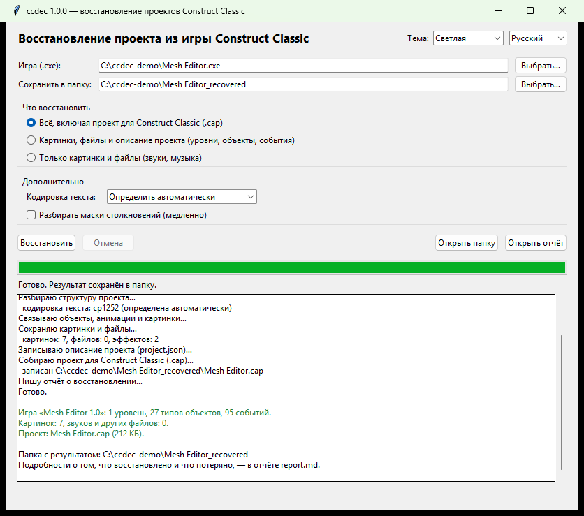
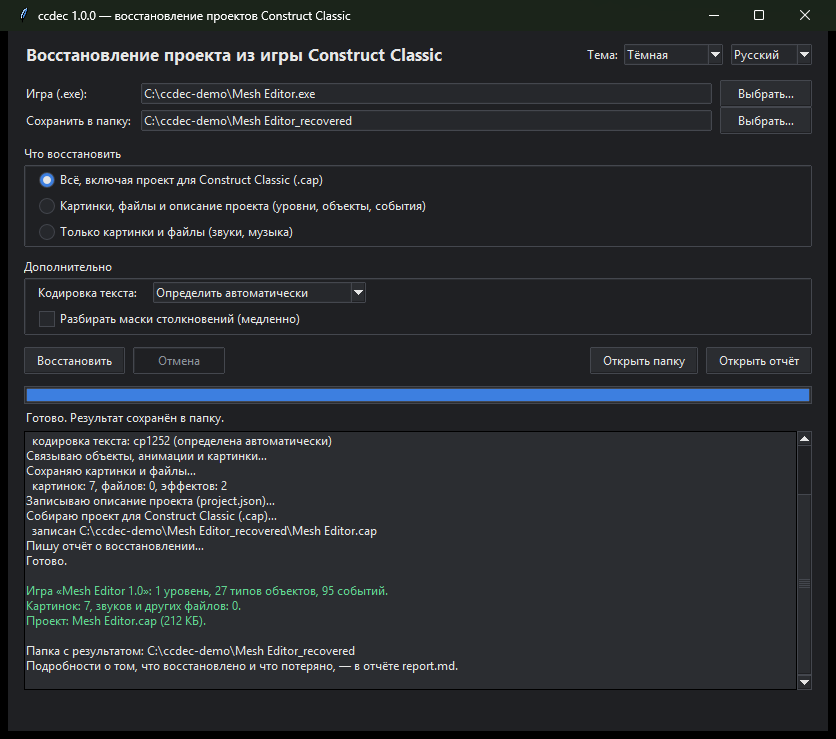

# ccdec — восстановление проектов Construct Classic из готовых игр

**[English version](README.md)**

Потеряли `.cap` игры, сделанной в **Construct Classic** (0.99.x – r2), но остался `.exe`?
`ccdec` достаёт из него картинки, звуки, структуру проекта и события — и собирает `.cap`, который снова
открывается в Construct Classic.

- **Level 1** — ассеты: картинки с именами по объектам и анимациям, звуки и другие файлы, эффекты, иконка.
- **Level 2** — `project.json`: настройки, уровни, слои, объекты со свойствами, behaviors, families,
  глобальные переменные и всё дерево событий читаемым текстом.
- **Level 3** — проект `.cap` для Construct Classic.
- Отчёт: что восстановлено, что выбросил экспортёр и почему.

Игра не запускается: файл только читается, со строгой проверкой границ. Никакая защита не обходится —
Construct Classic хранит проект в `.exe` в открытом виде.

> **Используйте для своих игр или с разрешения автора.** ccdec создан, чтобы вернуть свою потерянную
> работу; не публикуйте чужие ассеты и проекты без согласия авторов.

## Скачать и запустить

1. Установите **Python 3.8 или новее** с [python.org](https://www.python.org/downloads/). Подходит
   Windows 7: берите Python 3.8.10 («Windows installer», 32- или 64-bit; нужен Windows 7 SP1 с обновлениями).
2. Скачайте `ccdec-<версия>.zip` со страницы [Releases](../../releases) и распакуйте куда угодно.
3. Запустите двойным щелчком **`ccdec-gui.pyw`** (если ничего не происходит — `ccdec-gui.bat`, он
   покажет ошибку).

| Светлая тема | Тёмная тема |
|---|---|
|  |  |

Выберите `.exe` игры, что восстановить, нажмите **Восстановить**. По окончании — **Открыть папку** и
**Открыть отчёт**. Окно на русском и английском, со светлой и тёмной темой («Как в системе» следует
режиму приложений Windows 10/11) — оба переключателя в правом верхнем углу, выбор запоминается.

Сторонние пакеты не нужны — только стандартная библиотека Python (для окна — tkinter; на Linux пакет
`python3-tk`).

Память: примерно 2,5–3 размера exe (игра на 160 МБ — около 450 МБ). На 32-битной системе обрабатываются
игры примерно до 500 МБ.

## Открытие результата в Construct Classic

Construct Classic — программа без поддержки Юникода. Если в игре русский текст или в пути к папке есть
кириллица, а Windows не русская, переключите язык программ без поддержки Юникода:
**Панель управления → Region → Administrative → Change system locale → Russian (Russia)** (галочку
«Beta: UTF-8» не ставить) и перезагрузитесь. Иначе редактор молча не открывает такие файлы и показывает
текст кракозябрами. ccdec предупреждает, когда это нужно.

Звуки и другие файлы подключены к `.cap` путями, как и в оригинальном `.cap`: держите папку `files`
рядом или переподключите файлы в списке Files редактора.

## Командная строка

```bash
python -m ccdec game.exe -o out --level 3 --report
```

| Ключ | Что делает |
|---|---|
| (без ключей) | сводка: блоки данных, плагины, файлы, разобранная структура |
| `--level 1` / `2` / `3` | ассеты / + `project.json` / + `<имя>.cap` |
| `--report` | отчёт о восстановлении (также `out/report.md`) |
| `--lang ru` / `en` | язык отчёта (по умолчанию — по системе) |
| `--compare-cap X.cap` | сравнить проект из exe с имеющимся `.cap` (код выхода 3 при различиях) |
| `--compare-exe X.exe` | сравнить с другим exe, например повторно экспортированным из пересобранного `.cap` |
| `--masks` | разобрать маски коллизий и сохранить собственные (медленно на больших картинках) |
| `--raw` | выгрузить сырые блоки и DLL плагинов в `out/raw` |
| `--encoding cp1251` | кодовая страница текста проекта (по умолчанию определяется сама: cp1251 или cp1252) |
| `-v`, `-vv` | подробный журнал |

Коды выхода: 0 — успех, 1 — файл не читается или `.cap` не собрать, 3 — сравнение нашло различия.

## Что восстановить нельзя

Экспортёр Construct выбрасывает данные, нужные только редактору. Их нельзя вернуть ни из какого `.exe`:

- **Листы событий и include** — в `.exe` один плоский список на layout.
- **Отключённые события и комментарии** — не экспортируются.
- **Точная запись выражений** — хранятся токены; `and`/`&`, `floor`/`int`, `.X`/`Объект.X` неразличимы.
  Смысл сохраняется.
- **Позиция триггера внутри группы** — экспортёр выносит такие события; ccdec возвращает их в группу,
  но в её конец.
- **Имена картинок и файлов** — восстанавливаются по объектам и анимациям, файлы нумеруются.
- **Исходники эффектов `.fx`** — только скомпилированный байткод (стандартные эффекты есть в Construct).
- **Списки Sounds/Music** — в `.exe` попадает только список Files.
- **Данные редактора** — папки объектов, иконки объектов, сетка, блокировки, отдельные картинки
  коллизий, дробные части координат.

Для плагинов без исходников типы параметров событий неизвестны. ccdec может доучиться по любому
сохранившемуся `.cap`:

```bash
python tools/learn_aces.py старый_проект.cap --encoding cp1251
```

## Насколько хорошо работает

Проверено на играх, для которых известен исходный `.cap`:

| | Результат |
|---|---|
| Картинки | побайтно совпадают с картинками в исходном `.cap` |
| События | всё дерево событий образца Mesh Editor (71 событие, 6 групп, 368 параметров) совпало с его `.cap` |
| Пересборка `.cap` | игра на 75 уровней: `.cap` открывается в Construct Classic r2, превью работает, повторный экспорт даёт эквивалентный `.exe` (`--compare-exe`) |
| Устойчивость | неизвестные плагины и повреждённые файлы не роняют программу; проблемы перечислены в отчёте |
| Версии | рантаймы 2009 (0.99.x) и 2011 (r1/r2) годов; форматы `.cap` v17 и v18 |

Пока не проверено на реальных играх: families, эффекты слоёв, transitions, Application-рантайм
(не DirectX), сборки старше 2009 года. Присылайте отчёты с таких игр — откройте issue и приложите
`report.md`.

Формат файлов с источником каждого факта описан в [FORMAT.md](FORMAT.md).

## Разработчикам

Структура модулей и команды — в [английском README](README.md#for-developers).

```bash
python -m unittest discover -s tests      # тесты
python tools/check_py38.py                # совместимость с Python 3.8 (Windows 7)
python tools/build_zip.py                 # архив dist/ccdec-<версия>.zip для релиза
```

## Лицензия

ccdec — свободная программа под **GNU General Public License версии 2 или (на ваш выбор) любой более
поздней версии**, см. [LICENSE](LICENSE) и [NOTICE](NOTICE). Часть кода основана на исходниках редактора
Construct Classic (GPL-2.0-or-later), © Scirra Ltd.

«Construct» — товарный знак Scirra Ltd. ccdec — независимый проект, не связанный со Scirra и не
одобренный ею.
